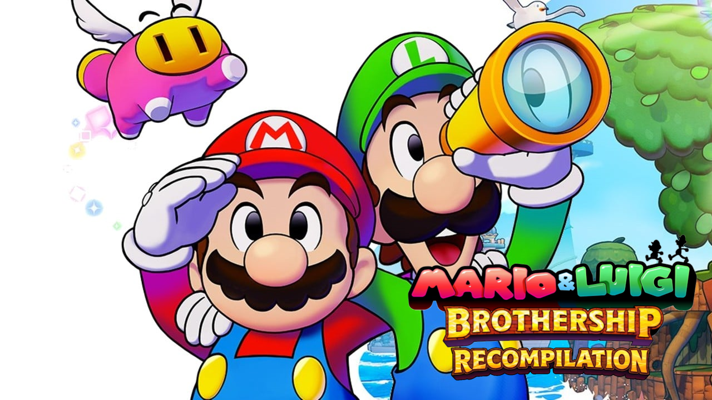

# Brothership Recomp

A static recompilation of *Mario & Luigi: Brothership* (Nintendo Switch, version 1.0.1) into a native PC program,
in the spirit of [XenonRecomp](https://github.com/hedge-dev/XenonRecomp) and
[N64Recomp](https://github.com/N64Recomp/N64Recomp): the game's code is translated ahead of time into C and compiled
for the PC, with the Switch's system services and its NVN graphics API provided by our own runtime (graphics on
Vulkan). On Windows and on Linux / the Steam Deck.

## Status

**Complete: version 1.0 (Windows, Linux and Steam Deck).** The whole game can be played from start to end - a
tester finished it at 60 fps on Windows. On Linux it runs as an AppImage, on the Steam Deck at 30 fps (720p). The
download is a launcher that installs the game from your own files: it unpacks your dump, translates and compiles the
game's code and prepares its shaders on your computer (about 10-15 minutes on a fast PC, longer on a Steam Deck;
~25 GB free disk space while it runs). Changes per version are in the [releases](../../releases).

## What you get

- **Frame rate:** 30, 60 or uncapped. 60 and above use the built-in 60FPS patch (see Thanks), with fixes for the
  timing differences found at 60 (battle actions, field events, a boss's attack).
- **Resolution:** 360p up to 4K (Auto follows the window), windowed or borderless; anti-aliasing FXAA, SMAA or off.
- **Effects:** bloom, film grain, vignette, auto exposure, chromatic aberration, lens flare and texture filtering
  (up to 16x), each adjustable.
- **Speed-up:** hold a button to run the game 2x to 10x as fast.
- **Languages and controls:** all 14 of the game's languages; button layout by Switch positions or by your
  controller's labels.

## Known limits

- The Steam Deck runs the game at 30 fps; 60 is not reached there.
- A few busy scenes (large crowds, some cutscenes) run below 60 fps even on fast PCs.
- About 0.5 % of the game's shaders are prepared the first time they are needed: a short stutter then.
- Cheat files (Atmosphere) do not work: they patch the Switch's machine code, which a recompiled game no longer runs.

Tested on PCs with NVIDIA and AMD graphics cards (Windows and Linux, including Wayland) and on the Steam Deck.

## Installing

### Windows

1. Download `BrothershipRecomp-Windows.zip` from the [releases](../../releases) and unzip it (not into Program Files).
2. Start `BrothershipRecomp.exe`.
3. **Settings > Game files:** the folder with your `.nsp` files (base game + 1.0.1 update).
   **Settings > Keys:** the folder with your `prod.keys`.
4. **Build**, then **Play**.

Settings, saves, the build and the caches live in `%LOCALAPPDATA%\brothership-recomp`. To report a problem,
attach `nxrt.log`, `build\build.log` and `build\unpack.log` from there (they never contain your keys).

### Linux and Steam Deck

1. Download `BrothershipRecomp-Linux.zip` from the [releases](../../releases) and unzip it.
2. Run `BrothershipRecomp-x86_64.AppImage` (no install; `chmod +x` it if it is not executable).
3. Set Game files and Keys with **Browse**, then **Build** and **Play**. For Game Mode on a Steam Deck, add the
   AppImage to Steam as a non-Steam game.

Settings, saves and the log live in `~/.config/brothership-recomp`, the build in `~/.local/share/brothership-recomp`
(the zip's `README.txt` has the details).

## No game content

This repository contains **no Nintendo code, assets or keys**, and never will. To play you need your own copy of
the game (base game and the 1.0.1 update) dumped from your own Switch, and your own keys (`prod.keys`) from that
console. The game is translated and compiled on your machine; nothing of it is
distributed. Please do not ask for game files or keys.

## What is here

- `lifter/` - the recompiler: AArch64 machine code to C.
- `runtime/` - what the recompiled code runs on: memory, threads, the Switch's system services, the NVN graphics
  layer on Vulkan (shader translation, resolution scaling, anti-aliasing), sound and input.
- `tools/` - build, packaging and test tools (the game builder's toolchain, shader seed, cross-compilation).
- `linux/` - the Linux package's build script, `AppRun` and desktop files.
- `tests/` - regression tests (a homebrew program run through the whole pipeline, platform tests).
- `third_party/` - libraries as git submodules (see [NOTICE.md](NOTICE.md)).

Building the launcher itself needs a developer setup (cross-compiled from WSL with clang; `tools/package_windows.sh`
makes the Windows download, `tools/package_appimage.sh` the Linux AppImage).

## Thanks

- **Rally** and **Blueji**, the testers, who were both extremely helpful in finding bugs.
- **Fl4sh_#9174**, for the 60FPS mod for *Mario & Luigi: Brothership*, built into the game here, and the speed cheat
  the Speed-up setting is modelled on.
- The projects listed in [NOTICE.md](NOTICE.md), whose code this one builds on.

## License

Copyright (C) 2026 The Brothership Recomp contributors.

This program is free software: you can redistribute it and/or modify it under the terms of the GNU General Public
License as published by the Free Software Foundation, either version 3 of the License, or (at your option) any
later version. See [LICENSE](LICENSE). Third-party code and its licences: [NOTICE.md](NOTICE.md).

Not affiliated with or endorsed by Nintendo. *Mario & Luigi* and *Nintendo Switch* are trademarks of Nintendo.
